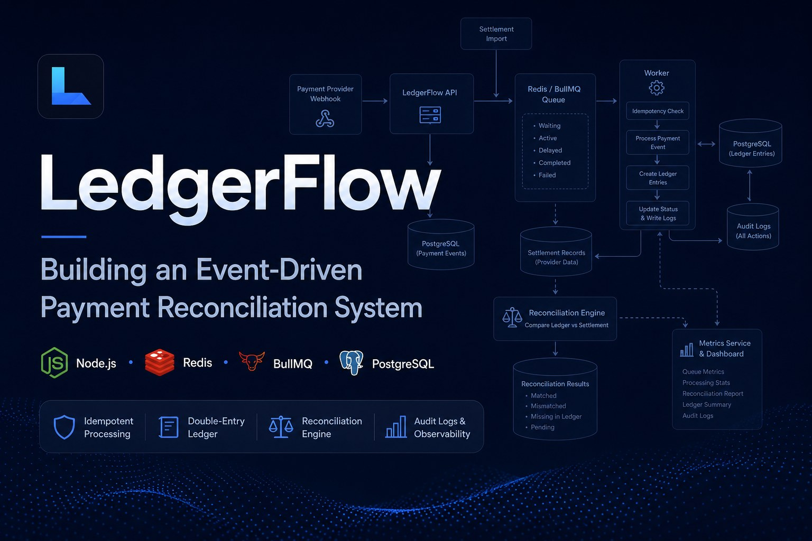

<p align="center">
  
</p>

<h1 align="center">LedgerFlow</h1>

<p align="center">
  <strong>Event-driven payment reconciliation and audit ledger infrastructure.</strong>
</p>

<p align="center">
Build reliable payment pipelines • Prevent duplicate processing • Generate immutable ledger entries • Reconcile settlements • Monitor operational health
</p>

<p align="center">


</p>

---

# What is LedgerFlow?

LedgerFlow is an event-driven payment reconciliation platform built to demonstrate how modern financial systems safely process payment events at scale.

Instead of simply accepting payments, LedgerFlow models the complete backend workflow behind a production payment system, including webhook ingestion, asynchronous processing, idempotency protection, double-entry ledger generation, settlement reconciliation, audit logging, and operational monitoring.

It was designed as a backend engineering project focused on reliability, observability, and scalable architecture.

---

# Why LedgerFlow?

A successful payment response is only the beginning.

Real financial systems must also answer questions like:

- Was this webhook delivered twice?
- Did the background worker fail?
- Was the customer charged twice?
- Does our ledger balance?
- Did the provider settlement match our records?
- Can every financial action be audited?
- Can engineers monitor the health of the processing pipeline?

LedgerFlow demonstrates how these problems can be solved using an event-driven architecture.

---

# Project Highlights

- Event-driven payment processing
- API key secured webhook endpoint
- Idempotent payment handling
- Redis + BullMQ background workers
- Double-entry ledger implementation
- Provider settlement import
- Automated reconciliation engine
- Queue metrics dashboard
- Audit logging
- Load tested with **5,000+ simulated payment events**
- Achieved **99.98% processing success rate**

---

# Architecture

<p align="center">

</p>

The complete architecture documentation is available here:

**📄 [Architecture Documentation](docs/ARCHITECTURE.md)**

---

# Technology Stack

| Layer | Technology |
|--------|------------|
| Runtime | Node.js |
| Framework | Express.js |
| Language | TypeScript |
| Database | PostgreSQL |
| ORM | Prisma |
| Queue | BullMQ |
| Queue Store | Redis |
| Security | API Keys, Helmet, Rate Limiting |
| Logging | Morgan |
| Containers | Docker |

---

# System Workflow

```text
Payment Provider
        │
        ▼
Webhook API
        │
        ▼
API Key Authentication
        │
        ▼
Rate Limiting
        │
        ▼
Idempotency Validation
        │
        ▼
Payment Event Stored
        │
        ▼
BullMQ Queue
        │
        ▼
Background Worker
        │
        ├──────────────► Create Ledger Entries
        │
        ├──────────────► Update Payment Status
        │
        ├──────────────► Create Audit Log
        │
        ▼
Settlement Import
        │
        ▼
Reconciliation Engine
        │
        ▼
Metrics Dashboard
```

---

# Payment Lifecycle

```
RECEIVED
     │
     ▼
QUEUED
     │
     ▼
PROCESSING
     │
     ├────────► FAILED
     │
     ▼
PROCESSED
```

---

# Key Features

- Payment webhook ingestion
- API key authentication
- Idempotency protection
- Queue based asynchronous processing
- Double-entry accounting
- Settlement reconciliation
- Audit logging
- Queue monitoring
- System metrics
- Failure recovery
- Rate limiting
- Engineering observability

---

# Load Testing

LedgerFlow was stress-tested using a custom simulation script that pushed more than **5,000 payment events** through the complete processing pipeline.

## Results

- 5,000+ simulated payment events
- 99.98% processing success rate
- Redis-backed asynchronous processing
- PostgreSQL persistence
- Ledger generation
- Settlement reconciliation
- Live queue metrics
- Audit trail generation

Example metrics:

```json
{
  "totalPaymentEvents": 6598,
  "totalProcessedJobs": 6597,
  "successRate": 99.98
}
```

---

# API Overview

<details>

<summary><strong>View Main API Endpoints</strong></summary>

## Health

```
GET /health
```

## Database Test

```
GET /api/test/db
```

## API Keys

```
POST /api/api-keys
```

## Paystack Webhook

```
POST /api/webhooks/paystack
```

## Payment Events

```
GET /api/payment-events
```

## Ledger

```
GET /api/ledger
```

## Ledger Summary

```
GET /api/ledger/summary
```

## Settlement Import

```
POST /api/settlements

POST /api/settlements/bulk
```

## Reconciliation

```
POST /api/reconciliation/:settlementId

POST /api/reconciliation/run-pending

GET /api/reconciliation/report
```

## Queue Metrics

```
GET /api/queues/payment/stats

GET /api/queues/payment/failed
```

## Metrics

```
GET /api/metrics
```

## Audit Logs

```
GET /api/audit-logs
```

</details>

---

# Local Development

```bash
npm install
```

Start Redis

```bash
docker run --name ledgerflow-redis -p 6379:6379 -d redis
```

Run migrations

```bash
npx prisma migrate dev
```

Generate Prisma Client

```bash
npx prisma generate
```

Start development server

```bash
npm run dev
```

---

# Engineering Concepts

LedgerFlow demonstrates production backend concepts including:

- Event-driven architecture
- Queue based processing
- Idempotency
- Double-entry accounting
- Database transactions
- Reconciliation
- Audit logging
- Operational metrics
- Background workers
- Failure recovery
- State machines
- Distributed backend workflows

---

# Roadmap

- ✅ Payment webhooks
- ✅ API key authentication
- ✅ BullMQ workers
- ✅ Redis queues
- ✅ Double-entry ledger
- ✅ Settlement reconciliation
- ✅ Queue metrics
- ✅ Audit logging
- ✅ Load testing

### Planned

- ⏳ Stripe integration
- ⏳ Flutterwave integration
- ⏳ PayPal integration
- ⏳ Event replay
- ⏳ Dead-letter queue
- ⏳ Multi-tenant organisations
- ⏳ Grafana dashboards

---

# Contributing

Contributions, suggestions, and improvements are welcome.

If you'd like to improve LedgerFlow, feel free to open an issue or submit a pull request.

---

# License

MIT License.