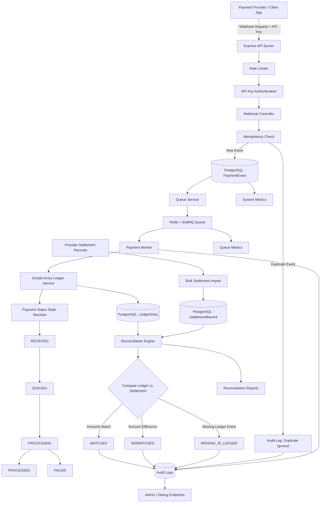

# LedgerFlow Architecture

LedgerFlow is an event-driven payment reconciliation and audit ledger system designed to simulate how fintech platforms process payment webhooks, protect against duplicate events, create double-entry ledger records, and reconcile internal transactions against provider settlement records.

## System Flow



## Core Backend Concepts Demonstrated

### 1. Webhook Ingestion

LedgerFlow receives payment events from simulated payment providers such as Paystack, Stripe, or PayPal.

The webhook layer is responsible for:

- Receiving external payment events
- Validating required fields
- Protecting provider endpoints with API keys
- Preventing duplicate processing using idempotency checks

---

### 2. Idempotency Protection

Payment providers can send the same webhook more than once.

LedgerFlow prevents duplicate processing using this unique database rule:

```txt
provider + providerEventId must be unique
```

This ensures the same payment event cannot be processed twice.

---

### 3. Background Processing with BullMQ

Webhook endpoints should respond quickly.

Instead of doing heavy ledger work inside the request cycle, LedgerFlow pushes payment events into a BullMQ queue backed by Redis.

```txt
Webhook received → PaymentEvent saved → Job queued → Worker processes ledger
```

This improves reliability, scalability, and failure recovery.

---

### 4. Payment Event State Machine

Each payment event moves through a clear lifecycle:

```txt
RECEIVED → QUEUED → PROCESSING → PROCESSED
```

If something fails:

```txt
PROCESSING → FAILED
```

This makes the system easier to debug and closer to real production fintech systems.

---

### 5. Double-Entry Ledger

For every successful payment event, LedgerFlow creates two ledger entries:

```txt
CREDIT CUSTOMER_PAYMENT_ACCOUNT
DEBIT  PROVIDER_CLEARING_ACCOUNT
```

This allows the system to verify that financial records are balanced.

---

### 6. Settlement Reconciliation

LedgerFlow compares internal ledger records against external provider settlement records.

Possible reconciliation outcomes:

```txt
MATCHED
MISMATCHED
MISSING_IN_LEDGER
PENDING
```

This helps detect:

- Amount mismatches
- Missing payment events
- Provider settlement issues
- Internal processing errors

---

### 7. Audit Logging

Important system actions are recorded in audit logs.

Examples:

```txt
PAYMENT_EVENT_QUEUED
PAYMENT_JOB_STARTED
PAYMENT_JOB_COMPLETED
PAYMENT_JOB_FAILED
RECONCILIATION_MATCHED
RECONCILIATION_AMOUNT_MISMATCH
DUPLICATE_WEBHOOK_DETECTED
```

Audit logs make the system explainable and useful for compliance-style debugging.

---

### 8. Metrics and Observability

LedgerFlow exposes backend metrics such as:

- Total payment events
- Processed events
- Failed events
- Queued events
- Processing events
- Success rate
- Queue job counts
- Reconciliation report summaries

This gives visibility into system health and operational performance.